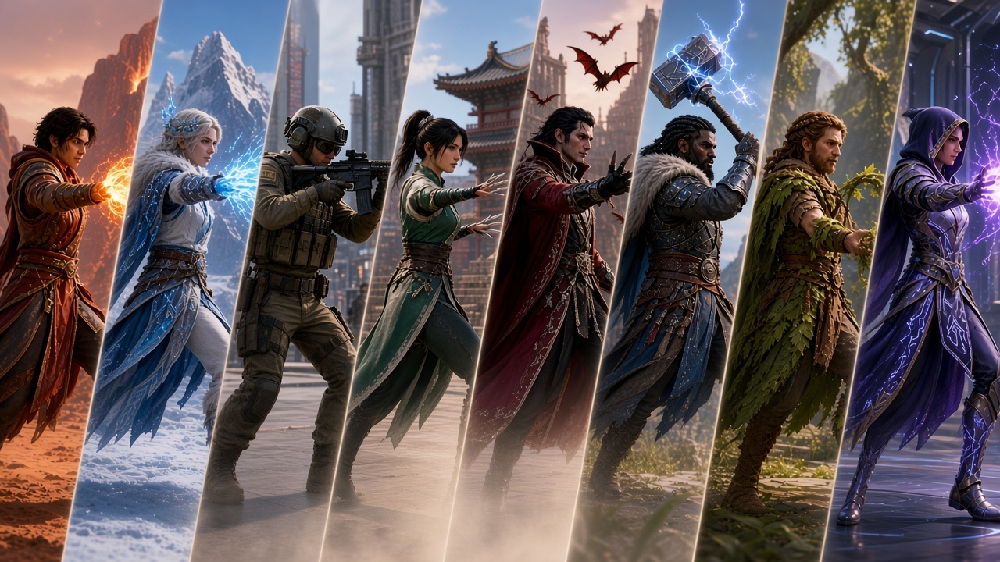

<div align="center">

# GameWM: Toward Next-Generation Video Games with Interaction-Centric World Models

<p>
<a href="https://hebing-sjtu.github.io/">Bing He</a><sup>*</sup> &nbsp;
<a href="https://rainzor.github.io/">Runze Wang</a><sup>*,†</sup> &nbsp;
<a href="https://char-1232323.github.io/zhafei.io/">Fei Zha</a><sup>*</sup> &nbsp;
Zhongyuan Wu &nbsp; Ke Xu<br>
Tao Zhuang &nbsp; Yuxuan Xie &nbsp; Zhongyuan Liu<sup>‡</sup>
<br>
<sub>Lightspeed Studios, Tencent</sub>
<br>
<sub><sup>*</sup>Equal contribution &nbsp; <sup>†</sup>Project lead &nbsp; <sup>‡</sup>Corresponding author</sub>
</p>

<p>
  <a href="https://arxiv.org/abs/2611.19247"></a>
  <a href="https://hebing-sjtu.github.io/GameWM-website/"></a>
  <a href="https://huggingface.co/binghe-sjtu/GameWM"></a>
</p>



<i>One engine mechanic. Many realizations.</i>

</div>

**GameWM** makes a video model a component of a game rather than its replacement.
The **engine** keeps what must be exact: rules, state, camera, layout and the coarse
motion of every interaction. The **video model (VM)** generates what is expensive to
author by hand: the look of the world and the detail of each interaction. One ranged
attack becomes a fireball, a blood bolt or a lightning call, while the target, the hit
frame and the damage stay exactly as the engine computed them.

- **Engine as a contract.** Any engine fills the role if it supplies a proxy video and
  an event log; the VM never has to remember the world.
- **Interaction-centric data.** Training pairs are cut around interactions, and each
  proxy is paired with several targets, so one proxy has more than one correct output.
- **One model family, 5B to 33B.** GameWM-Wan2.2-5B, GameWM-Wan2.2-14B and
  GameWM-H3-33B, from real-time play to offline content.

## Repository

| Directory | Role |
|---|---|
| [`GameWM-engine/`](GameWM-engine) | Engine → VM request protocol, reference implementation and the training-ground sample game |
| [`GameWM-VM/`](GameWM-VM) | Proxy-conditioned training and inference for the model family, built on SolarWM |

```bash
git clone --recurse-submodules https://github.com/hebing-sjtu/GameWM.git
```

## Weights

All weights are in one Hugging Face repository,
[binghe-sjtu/GameWM](https://huggingface.co/binghe-sjtu/GameWM), one folder per model. The
bidirectional (BD) models are released; the causal AR and DMD students are not released yet.
Backbones are downloaded separately.

| Model | Variants | Backbone | License |
|---|---|---|---|
| [GameWM-H3-33B](https://huggingface.co/binghe-sjtu/GameWM/tree/main/GameWM-H3-33B) | BD, BD-Sheet | [MiniMax-H3](https://huggingface.co/MiniMaxAI/MiniMax-H3) | MiniMax H3 Community License (territory restricted) |
| [GameWM-Wan2.2-14B](https://huggingface.co/binghe-sjtu/GameWM/tree/main/GameWM-Wan2.2-14B) | BD, BD-Sheet | [Wan2.2-I2V-A14B](https://huggingface.co/Wan-AI/Wan2.2-I2V-A14B) | Apache-2.0 |
| [GameWM-Wan2.2-5B](https://huggingface.co/binghe-sjtu/GameWM/tree/main/GameWM-Wan2.2-5B) | BD, BD-Sheet | [Wan2.2-TI2V-5B](https://huggingface.co/Wan-AI/Wan2.2-TI2V-5B) | Apache-2.0 |

```bash
hf download binghe-sjtu/GameWM --include "GameWM-Wan2.2-5B/BD-Sheet/*" --local-dir GameWM-weights
```

Inference commands for each model are in the
[model card](https://huggingface.co/binghe-sjtu/GameWM) and in [`GameWM-VM/`](GameWM-VM).
The training data is not released.

## Citation

```bibtex
@misc{he2026gamewm,
  title         = {GameWM: Toward Next-Generation Video Games with Interaction-Centric World Models},
  author        = {Bing He and Runze Wang and Fei Zha and Zhongyuan Wu and Ke Xu and Tao Zhuang and Yuxuan Xie and Zhongyuan Liu},
  year          = {2026},
  eprint        = {2611.19247},
  archivePrefix = {arXiv},
  url           = {https://arxiv.org/abs/2611.19247}
}
```
